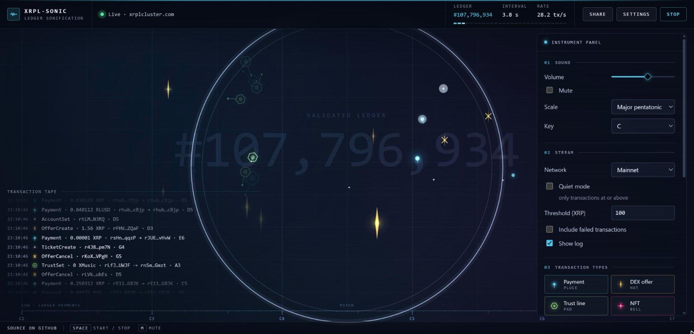

# xrpl-sonic

**Listen to the XRP Ledger: every transaction becomes a sound, every ledger close a pulse.**

Live: **https://quigles1337.github.io/xrpl-sonic/**

[](https://github.com/Quigles1337/xrpl-sonic/actions/workflows/test.yml)
[](https://github.com/Quigles1337/xrpl-sonic/actions/workflows/pages.yml)
[](LICENSE)



xrpl-sonic is a single page with no dependencies and no build step. It opens a WebSocket to a public XRPL node, subscribes to the `ledger` and `transactions` streams, and turns what arrives into synthesised sound and a field of tracks with the Web Audio and Canvas APIs. Press **Start**, turn the volume down, and listen to the network settle one ledger at a time.

## Sound mapping

| Transaction type | Sound | Pitch / variation | Track on the plate |
| --- | --- | --- | --- |
| `Payment` | Plucked, kalimba-like tone | `log10(amount in XRP)` picks a scale degree across five octaves: dust is high, whales are low. Payments of 100,000 XRP and above add a sub-bass drop. Issued-currency payments use a reedier timbre and a hollow track. | A photon with a comet tail. Whales glow wider and leave a Cherenkov ring; issued-currency payments are hollow. |
| `OfferCreate` / `OfferCancel` | Closed hi-hat / rim tick | Stage position per account, so market makers become recognisable. | A spectral line: a thin vertical flash with a glint at ignition. A cancelled offer is struck through. |
| `TrustSet` | Soft pad swell (root + fifth) | One note per issuer. | A hexagonal cell that grows a bond to its issuer, like a crystal forming. |
| `NFTokenMint`, `NFTokenCreateOffer`, other `NFToken*` | FM bell | Upper register, keyed on the token or taxon. | A four-point star with a lens flare at ignition, turning slowly. |
| `EscrowCreate` / `EscrowFinish` / `EscrowCancel` | Reverse-cymbal swell | `EscrowFinish` resolves into a chime; pitch from the escrowed amount. | A dial that winds shut on create, springs open on finish and is struck through on cancel. |
| `PaymentChannel*` | Four-note ascending arpeggio | Keyed on the channel. | Four bars that light in step with the arpeggio, climbing to the right. |
| `AMM*` | Soft triad | Keyed on the pool's asset. | Three overlapping rings, breathing together. |
| Everything else (`AccountSet`, `TicketCreate`, `Batch`, `Check*`, ...) | Quiet click | Stage position per account. | A single bright mote. |
| Ledger close | Low tick with a pitch drop | The inter-close interval (usually 3–5 s) runs as a segmented metronome in the command strip. | A ring from the centre of the plate; the grid lights up and the ledger number is stamped faintly behind it. |

Only validated, successful transactions sound by default; there is a toggle for failed ones. Eight scales (major and minor pentatonic, major, Dorian, Lydian, blues, Hirajoshi, whole tone) and twelve keys are available.

### The plate

The canvas is laid out like a cloud chamber for a ledger. The horizontal axis is pitch, with a ruler along the bottom marking the octaves (C2 to C7); because payments map amount to pitch, whales land on the left and dust on the right, and a busy issuer or market maker shows up as a column of identical tracks at one position. Every track ignites with a white-hot flash, scales in with a little overshoot and fades on the same schedule as its sound. The same glyphs appear as the legend tiles under **Settings → Transaction types**, on the start screen and beside every line of the transaction tape, so shape, colour and sound are learned together. The field guide lives in `src/glyphs.js`; the renderer in `src/visual.js` keeps it cheap with cached glow sprites, cached grid and ruler layers, capped track counts and no `shadowBlur`.

### Staying musical when the ledger is busy

Transactions do not trickle in: each validated ledger arrives as a burst of anything from 50 to 600 transactions every few seconds. The audio engine spreads each burst across the expected inter-ledger interval, caps polyphony, and applies a short per-type cooldown. Events that do not fit are rate-limited rather than queued, so the sound never drifts behind the ledger; they still appear as dimmer tracks. The **Session** panel shows how many were played versus rate-limited. **Quiet mode** keeps only transactions at or above a chosen XRP amount.

## Follow a cast

**Settings → Cast** follows up to five accounts. Each member gets a voice of its own (marimba, glass, brass, reed or pulse), a place in the stereo field, a colour and a label, so the same participant sounds and looks the same every time it acts: the market maker is the brass on the left, the issuer the glass in the centre. **S** solos a member (only soloed members sound), **M** mutes one, and **▶** plays the member's three-note motif, so you can learn a voice before you listen for it. Transactions that involve nobody in the cast are played in their category voice (**Play everything**), drawn dimmed and silent (**Mute others**) or not drawn at all (**Hide others**).

A transaction involves a member when the member is the sender, the destination, or appears in the transaction's metadata (`AffectedNodes`), which covers trust lines, consumed offers, issued-currency flows and anything else that touched one of its ledger entries. Involvement is a filter: it says the account appears in the record, not how much value it gained or lost, whether an order filled, or whether two addresses share a controller. A transaction involving several members is one event, counted once: the sender's voice (or the first involved member's) plays the note and each other involved member is heard as a short cue in its own voice just after it. On the plate a member's track carries a ring in its colour and its label; when two members meet in one transaction a bond is drawn between their tracks, and the tape shows who else was involved.

The cast travels in the URL as `#cast=`, so a link carries it:

```
https://quigles1337.github.io/xrpl-sonic/#cast=rBTwLga3i2gz3doX6Gva3MgEV8ZCD8jjah~Maker~brass~-0.6,rKNRrawfVS59C3tN1bBiUWc5wZQAfUPh7z~Issuer
```

`#account=<r-address>` still works as the one-member shortcut: it follows that account and mutes everything else, as it always has. Addresses are validated as base58 r-addresses and the cast is shown in the command strip, each chip linking to the explorer.

Every line in the log is a link: the transaction opens on an explorer, each account opens its account page, and ledger lines open the ledger. The default explorer is XRPScan; Bithomp and xrpl.org are selectable, and the testnet equivalents are used when the page is on testnet. Links open in a new tab with `rel="noopener noreferrer"`.

## Replay a ledger, with a permalink

`#replay=<ledgerIndex>` plays one validated ledger back; `#replay=<from>-<to>` plays a range (up to 50 ledgers). A real mainnet example:

```
https://quigles1337.github.io/xrpl-sonic/#replay=107777809
```

Press **Start** and the page fetches each ledger over the same WebSocket (`{"command":"ledger","ledger_index":N,"transactions":true,"expand":true}`), sorts its transactions by `TransactionIndex` (the order the ledger applied them; the node returns them in hash order) and spreads them evenly across the interval the ledger actually stayed open, taken from the next ledger's `close_time` (4 s when that is not available). That reconstructs a listening sequence; it does not recover when each transaction was submitted or executed, so a repeated phrase shows repeated ordering under the chosen mapping, not reaction latency or causation.

The ledgers become a **score** (every ledger close, every event with its voice, notes and timing, every annotation at its time) and a **transport** plays it:

| Control | Key | What it does |
| --- | --- | --- |
| ▶ / ❚❚ | `K` | Play or pause. |
| ⏭ | `.` | Step: play exactly the next event and stay there. |
| ⏮ | `,` | Step back to the previous event (without playing it). |
| ⟲ | `L` | Loop the whole case, or the in/out range. |
| `[` `]` | `[` `]` | Set the loop's in and out points at the current position. |
| Track | `←` `→` `Home` `End` | Seek. Marks on the track: ledger closes, gaps between clips (hatched), annotations (diamonds; the magenta ones pause). |
| Speed | | 0.5×, 1×, 2×, 4×. |
| Go live | `Esc` closes the inspector | Return to the live stream. |

Click any line on the tape, or any track on the plate, to open the **inspector**: type and result, amount, parties (with cast labels), ledger and hash as explorer links, the voice and note that played it, whether it sounded or was drawn silent, its position in the case, and the annotations anchored to it, with Previous / Next to walk the score one event at a time.

**Share** copies a permalink to the ledger currently playing (live or replayed) together with the network and the cast, so a moment you heard can be sent to someone else.

## Cases

A **case** is a small JSON file that describes a listening: the network, one or more ledger windows (clips), the cast, the filters and mapping, the speed, and annotations anchored to a transaction, a ledger or a position on the timeline. **Settings → Case** loads one, saves the current one, copies a link that carries it (`#case=`), and saves the **transcript**, a text version of the whole score with every ledger, gap, event and annotation at its time. Changing the scale, key, filters or cast while a case plays rebuilds the score in place, so the file and the link always describe what you are hearing. The silence between clips is explicit: a gap is announced on the tape, in the captions and as a contracting dashed ring on the plate. The format is documented in [docs/case-format.md](docs/case-format.md); the same case and ledgers always give the same score, and a recording (**Capture**) preserves a particular performance.

**Captions** show annotations, gaps and cast events as text; **Speak annotations** reads each note aloud through the browser's speech synthesis, independent of the instrument's sound; **Pause at annotations** honours notes that ask for it. The page respects `prefers-reduced-motion` (tracks still appear, without drift, overshoot or flashes), and every control is reachable from the keyboard.

## Overlay and embed

**`?overlay=1`** strips the page down to the transparent canvas — tracks and rings only, with no controls, grid, ruler or ledger stamp — for OBS, streaming layouts and wall screens. The stream starts on load; sound starts as soon as the page receives any click or key press, because browsers block audio until a gesture. Two ways to satisfy that in OBS:

1. Add a **Browser Source** with the URL `https://quigles1337.github.io/xrpl-sonic/?overlay=1` (optionally `#account=` or `#replay=`), then right-click the source, choose **Interact**, and click once inside the page. Audio stays on for the life of the source.
2. Launch the browser with `--autoplay-policy=no-user-gesture-required` (Chrome, Chromium, Edge; OBS passes it through where its build exposes CEF flags), and no interaction is needed.

**`?embed=1`** keeps a compact top bar with a small **Start** button, the log and the visualiser, for an iframe:

```html
<iframe
  src="https://quigles1337.github.io/xrpl-sonic/?embed=1"
  width="640" height="360" loading="lazy" allow="autoplay"
  style="border: 0; border-radius: 12px"
  title="xrpl-sonic — listen to the XRP Ledger"></iframe>
```

Both modes honour `?network=testnet`, `#account=` and `#replay=`, so an embed can watch one account or replay a specific ledger. An **Open full page** link in the embed leads to the same URL with the full controls.

## Snapshot and recording

**Settings → Capture → Snapshot** composes the scene with a small stats box (network, ledger index, transactions in the last minute, timestamp, site URL) on an offscreen canvas and downloads it as `xrpl-sonic-<ledger>.png`. **Record 30 s** captures the canvas (`canvas.captureStream(30)`) together with the audio mix (a `MediaStreamDestination` on the master bus) through `MediaRecorder` and downloads `xrpl-sonic-<ledger>.webm` when the countdown ends — `video/webm;codecs=vp9,opus`, falling back to `vp8,opus`. The button is disabled where `MediaRecorder` or `canvas.captureStream` is missing (Safari records in a different container; use a screen recorder there).

## How it works

The page sends `{"command":"subscribe","streams":["ledger","transactions"]}` to a public rippled or Clio node over WebSocket (`wss://xrplcluster.com` by default, rotating to `s1.ripple.com` and `s2.ripple.com` on failure, with capped exponential backoff and an idle watchdog; testnet uses `s.altnet.rippletest.net:51233`). Every `transaction` message goes through a pure mapping function (`src/mapping.js`) that reads the type, the delivered amount (`meta.delivered_amount`, then `DeliverMax`, then `Amount`, so partial payments report what actually moved) and the accounts involved, and returns a sound event: category, scale degree, velocity, duration, colour and size. The audio engine (`src/audio.js`) synthesises that event from oscillators and generated noise through a compressor and a synthetic convolution reverb, and the visualiser (`src/visual.js`) draws its track at the same scheduled instant. `ledgerClosed` messages drive the tick, the ring and the metronome.

Everything runs in the browser from static files. There is no server, no build, no framework and no package to install.

## Running locally

```sh
git clone https://github.com/Quigles1337/xrpl-sonic.git
cd xrpl-sonic
npx --yes serve -l 4173 .        # or: python -m http.server 4173
```

Then open http://localhost:4173/. ES modules need an HTTP origin, so opening `index.html` from the filesystem will not work.

Useful query parameters: `?network=testnet`; `?autostart=1` for kiosk setups (visuals start immediately, sound on the first tap unless the browser allows audio without a gesture); `?overlay=1` and `?embed=1` (see above). Hash parameters carry shareable state: `#account=<r-address>` and `#replay=<ledger>` or `#replay=<from>-<to>` (see above).

Keyboard: `Space` starts and stops, `M` mutes.

## Tests

```sh
node --test          # Node 20 or newer, no dependencies
node scripts/smoke.mjs   # Node 22+: connect to mainnet and print what the first transactions would sound like
```

The mapping layer has no DOM or Web Audio imports, so it is tested against fixture stream messages in `test/fixtures/` (API v1 `transaction` and v2 `tx_json` shapes, XRP in drops, issued currencies, hex currency codes, partial payments, `DeliverMax`, failed transactions, and one of every sound category). Account matching (`involvesAccount`), explorer URL building, URL parsing, replay scheduling (`scheduleReplay`, tested against a trimmed real mainnet ledger), the field guide (`src/glyphs.js`: one shape per category, variant resolution, the pitch ruler and the legend icons) and the capture helpers (MIME selection, filenames, overlay text) are pure and have their own tests. The WebSocket client is tested with a scripted socket and fake timers.

## Privacy

Your browser connects directly to the public XRPL node you choose. Nothing is sent anywhere else: no analytics, no backend, no cookies. Settings are kept in your browser's localStorage only.

## Questions and ideas

Open a thread in [Discussions](https://github.com/Quigles1337/xrpl-sonic/discussions) — mapping suggestions, new voices, node endpoints and accessibility feedback are all welcome. Bugs go in [Issues](https://github.com/Quigles1337/xrpl-sonic/issues).

## Related

- [commit-tapestry](https://github.com/Quigles1337/commit-tapestry) — weaves a repository's git history into a textile SVG.
- [agent-blame](https://github.com/Quigles1337/agent-blame) — measures AI co-authorship in a repository from `Co-Authored-By` trailers.

## License

[MIT](LICENSE) © 2026 Quigles1337
